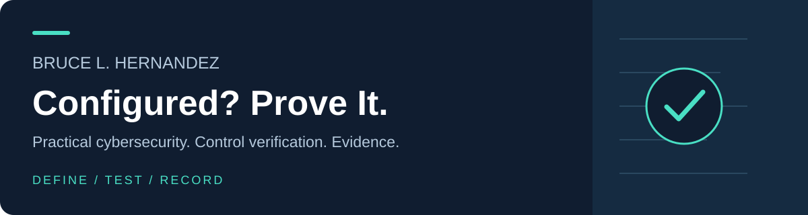

# Bruce L. Hernandez

I write about turning security requirements into working controls—and keeping evidence of the result.

**Configured? Prove It.** is the question behind the work here: what should a control allow, what should it deny, and what evidence shows the decision?

## Start with a working question

| If you want to… | Start here |
|---|---|
| Explore policies, queries, and verification cases | [Security Controls in Practice companion repository](https://github.com/hernandezbruce94-dev/security-controls-in-practice) |
| Record the expected and observed result of a test | [Verification record](https://github.com/hernandezbruce94-dev/security-controls-in-practice/blob/main/templates/verification-record.md) |
| Organize control ownership and evidence | [Control register](https://github.com/hernandezbruce94-dev/security-controls-in-practice/blob/main/templates/control-register.csv) |
| Review a change before operating acceptance | [Change checklist](https://github.com/hernandezbruce94-dev/security-controls-in-practice/blob/main/templates/change-record-checklist.md) |

## What you'll find here

- **Identity and least privilege:** access decisions, scope, and verification.
- **Network and cloud controls:** policy examples, queries, and test cases.
- **Operational evidence:** verification records, change checklists, and control registers.

The companion examples use fictional values and placeholders. **Documented** behavior and **Lab-tested** results are different evidence levels; review the repository's scope and test in an authorized non-production environment before adapting examples.

## Books and free resources

Author of **Cybersecurity Engineering in Practice** and **Security Controls in Practice: From Requirements to Working Enterprise Protection**.

[Explore the books](https://sites.google.com/view/bruce-l-hernandez-books/home?utm_source=github&utm_medium=referral&utm_campaign=github_profile&utm_content=readme_books) · [Free Security Control Verification Checklist](https://sites.google.com/view/bruce-l-hernandez-books/free-security-checklist?utm_source=github&utm_medium=referral&utm_campaign=github_profile&utm_content=readme_checklist)

## Connect and contribute

[LinkedIn](https://www.linkedin.com/in/bruce-hernandez-master-of-cyber-operations/) · [YouTube](https://www.youtube.com/@brucehernandez1136) · [DEV tutorial: test the decision, not just the error](https://dev.to/bruce_hernandez_e4218d514/a-failed-request-is-not-proof-of-blocking-test-the-decision-not-just-the-error-1i2)

Found a mismatch between an example and current vendor documentation? [Open a focused correction](https://github.com/hernandezbruce94-dev/security-controls-in-practice/issues) with the file, product/version context, and primary source. Useful evidence beats a confident guess.
