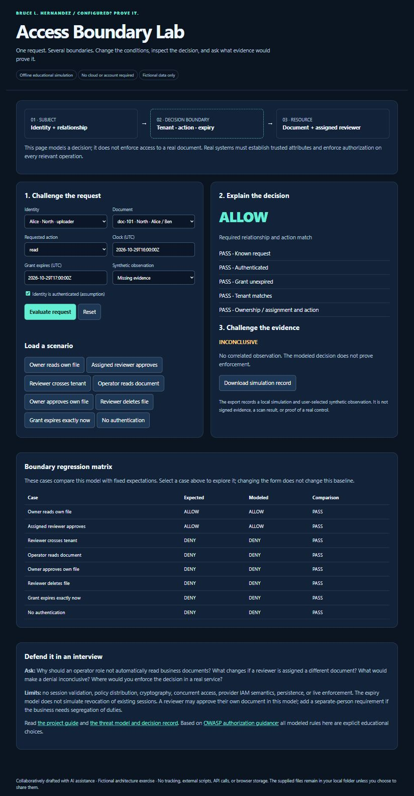

# Access Boundary Lab

An interactive, offline security engineering exercise by Bruce L. Hernandez, collaboratively drafted with AI assistance. Change the request, inspect an explainable authorization decision, and distinguish a modeled result from evidence of enforcement.

**Status:** locally implemented educational software with synthetic tests. Not a deployed service, production authorization library, vendor IAM emulator, or certification of a security control. No prior employment or customer work is claimed.



## Open it

Download this folder, keep `index.html` and `engine.js` together, then open `index.html` in a modern browser. No installation, cloud, API key, paid service, or account is needed. GitHub's normal file view displays source; it does not run the HTML. This project does not enable GitHub Pages or change repository settings.

Run the regression suite with an installed Node.js runtime:

```sh
node --test engine.test.cjs
```

Or inspect a decision in a terminal:

```sh
node -e "const l=require('./engine.js'); console.log(l.evaluate(l.scenarios[2]));"
```

## A three-minute demonstration

1. Load **Owner reads own file**. The decision is ALLOW; leave the observation missing and explain why the evidence assessment is INCONCLUSIVE.
2. Load **Reviewer crosses tenant**. Authentication and role are not enough; the tenant boundary denies it.
3. Load **Operator reads document**. Operational responsibility does not automatically confer business-data access.
4. Load **Grant expires exactly now**. The explicit exclusive expiry denies at the boundary, not one second later.
5. Select a synthetic ALLOW observation against that modeled DENY. Explain the MISMATCH and what real evidence would be needed before acceptance.
6. Download the simulation record and inspect its scope labels. It contains no real enforcement observation and is not signed or tamper-evident.

## The concrete model

North tenant: Alice uploads `doc-101`; Ben is its reviewer; Ops operates the service. South tenant: Cara owns and reviews `doc-202`. Known identities must be authenticated, within grant lifetime, and in the document's tenant. Reads require ownership or assignment. Approval requires the assigned reviewer role. Deletion is explicitly forbidden; unmatched requests deny. Inputs and timestamps that the model cannot interpret deny.

The form's clock is deliberately fixed, not your real wall clock. The expiry field simulates a grant lifetime; it does **not** simulate session revocation or a real identity provider. Reviewer self-approval is permitted for Cara in this model; a business requiring separate-person approval needs another constraint and tests. This is a discussion point, not an implied universal policy.

## What belongs in a real implementation

Trusted identity/tenant/assignment sources; server-side enforcement; issuer/audience/session validation; protected and current policy data; handling for revocation, concurrent changes, outages, and audit events; integration tests using a controlled service and harmless data. The browser controls here are user-editable assumptions and cannot establish trusted attributes.

The page has no external scripts, fonts, analytics, fetch calls, cookies, or browser storage. Only user-initiated source links navigate externally. Downloaded JSON contains the synthetic fields on screen. Keep real credentials and personal or customer data out of the exercise.

## Explore and extend

- [Threat model and architecture decision](design-review.md)
- [Interview challenge cards](interview-cards.md)
- [Engine and trace](engine.js)
- [Regression tests](engine.test.cjs)
- [Recorded validation and limits](TEST-RESULTS.txt)
- [Parent document-processing design](../../case-studies/document-processing-service.md)

This lab applies the deny-by-default and per-request authorization principles in the [OWASP Authorization Cheat Sheet](https://cheatsheetseries.owasp.org/cheatsheets/Authorization_Cheat_Sheet.html), reviewed October 29, 2026. Its specific roles, data and expiry rules are educational choices, not OWASP requirements. See the repository's existing reuse terms; no new license is implied.
